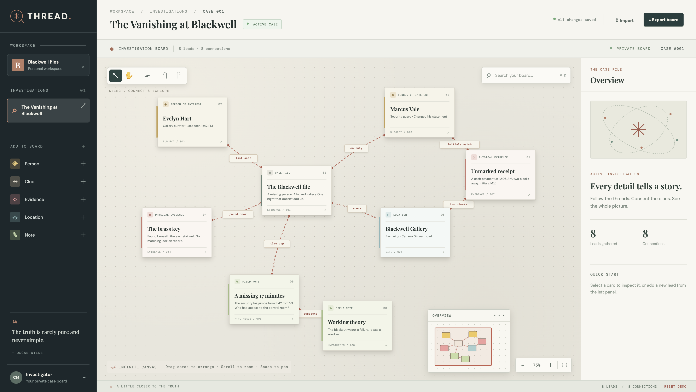
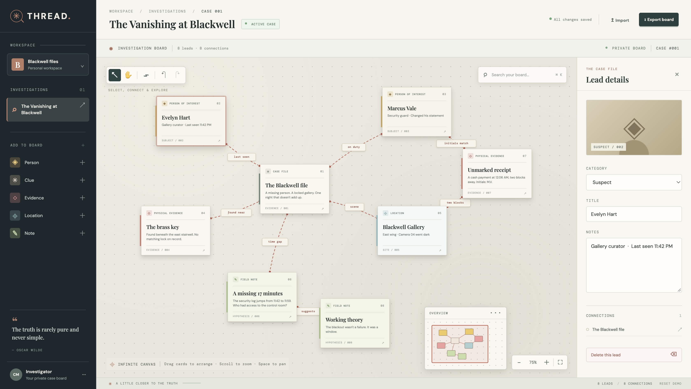
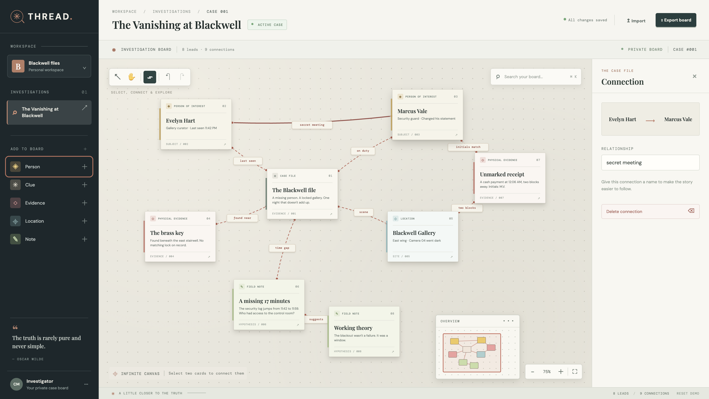

# THREAD — Infinite Detective Board

A small, dependency-free investigation canvas for arranging leads and following the connections between them. Built with native browser modules, CSS, SVG, and local storage.

[Try the live demo](https://mucz.github.io/infinite-detective-board/)



<details>
<summary>More UI screenshots</summary>

### Inspect a lead


### Connect two leads


</details>

## Run it

Requires a modern browser and Python 3 (or any static HTTP server). No package installation or account is needed.

```sh
npm run dev
# Open http://localhost:4173
```

The board opens with a sample Blackwell Gallery investigation. Data stays in your browser's local storage; **Export board** downloads a JSON backup and **Import** restores one. There is no backend or shared workspace.

## Explore

- Drag a card to move it; Shift-click to select multiple cards and drag them together.
- Drag the empty canvas, choose the hand tool, or hold **Space** to pan. Scroll to zoom around the pointer. Use the fit button or **0** to frame the case.
- Choose **Connect** and click two cards to link them; click a connection to rename or delete it.
- Add people, clues, evidence, locations, or notes from the left panel. Select a card to edit its title, notes, and type in the inspector.
- Search titles, notes, and categories with the search field or **⌘/Ctrl K**. Press Enter to jump to the first result.
- Undo and redo with **⌘/Ctrl Z** and **⌘/Ctrl Shift Z**. Delete removes the selected card(s) or connection; **Escape** cancels selection and connection mode.
- The mini-map shows the current viewport and can be clicked to navigate.

Shortcuts: **V** select · **H** pan · **C** connect · **0** fit · **Space** temporary pan.

## Test

```sh
npm run check
```

This runs JavaScript syntax checks and the `node:test` suite for board operations, import validation, viewport math, search, history, and the demo case. Node 20+ is required. GitHub Actions runs the same check on every push and pull request.

## Implementation notes

`src/board.js` is a pure immutable model for cards, connections, history, serialization, and viewport math. `src/app.js` handles DOM and pointer interactions. `src/demo.js` contains the sample case. An investigation is stored under a versioned local-storage key. Imported JSON is normalized and dangling links are discarded. The canvas is a CSS-transformed world with SVG connections; there is no fixed world boundary.

The app intentionally avoids external JavaScript dependencies. Fonts use Google Fonts when available and fall back to system fonts offline.
